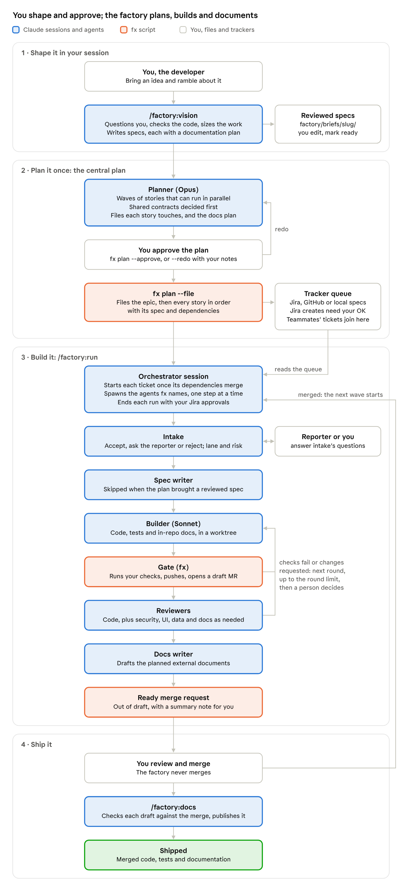

# Software factory

A Claude Code plugin that turns an idea, a Jira ticket, a GitHub issue or a
local spec file into a checked, reviewed and documented draft merge request.
You shape the work and make the decisions; agents plan, build, check and
document everything in between. Nothing merges without you.



## Install

```
claude plugin marketplace add MarkIla/software-factory
claude plugin install factory@software-factory
```

For a private repository, git must be able to read it without prompting:
`gh auth login && gh auth setup-git` does that for GitHub. Then, in each repo
or multi-repo workspace, open Claude Code and run `/factory:setup`.

You need Claude Code, Python 3.9+, git 2.38+, and `glab` or `gh` logged in.
For Jira at work, connect the Atlassian MCP; no Jira token is needed.

## Use

| Command | What it does |
| --- | --- |
| `/factory:setup` | Sets up a repo or workspace: config, checks, permissions, health check |
| `/factory:vision` | Turns an idea into reviewed specs, has the planner plan the whole build for your approval, then queues it |
| `/factory:run` | Works the queue: intake, spec, build, checks, reviews, docs, ready merge requests; then asks you to approve its Jira writes |
| `/factory:docs` | Publishes the documentation drafts of merged work |

## Documentation

| Page | Covers |
| --- | --- |
| [Getting started](docs/getting-started.md) | Installing, setting up a project, your first piece of work, troubleshooting |
| [How it works](docs/how-it-works.md) | The parts, a job's life, the central plan, the Jira bridge, documentation, safety |
| [Commands](docs/commands.md) | Every slash command and `fx` command |
| [Configuration](docs/configuration.md) | `factory/config.json`, profiles, workspaces, the checks script |
| [Development](docs/development.md) | Layout, tests, changing the plugin, releasing a version |

## Update

```
claude plugin marketplace update software-factory
claude plugin update factory@software-factory
```

Or turn on auto-update once under `/plugin` → Marketplaces. Each project's
`factory/` folder (config, checks, jobs, specs) is untouched by updates.
