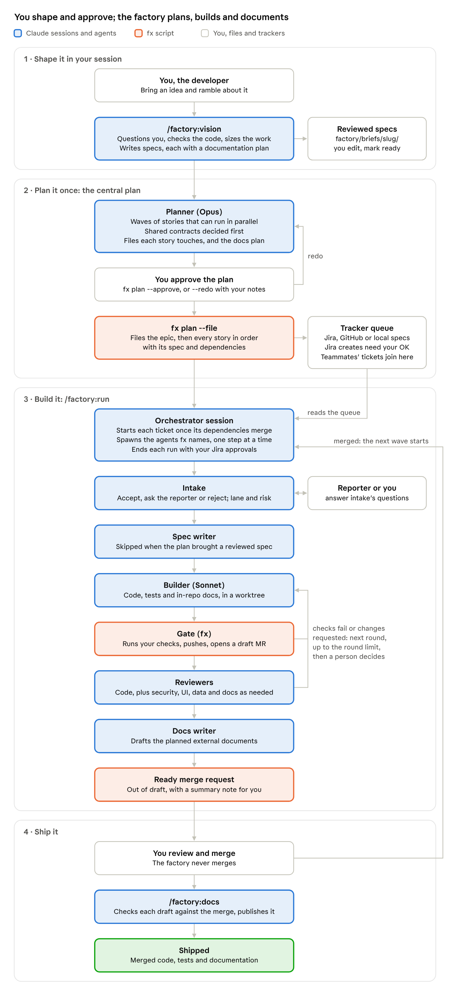

# Software factory documentation

The software factory is a Claude Code plugin that turns an idea, a Jira
ticket, a GitHub issue or a local spec file into a checked, reviewed and
documented draft merge request. You shape the work and make the decisions;
agents plan, build, check and document everything in between. Nothing merges
without you.

You make five decisions along the way: the specs, the plan, each run's Jira
writes, the merge, and each published document.

## Pages

| Page | Read it when |
| --- | --- |
| [Getting started](getting-started.md) | You're installing the plugin, setting up a project, or running it for the first time |
| [How it works](how-it-works.md) | You want to know what each part does, how a job moves, how Jira is reached and what keeps it safe |
| [Commands](commands.md) | You need the exact skill or `fx` command and its flags |
| [Configuration](configuration.md) | You're editing `factory/config.json` |
| [Development](development.md) | You're changing the plugin itself, running its tests or releasing a version |

## In one minute

- **Install once per machine**, then run `/factory:setup` once per repo or
  multi-repo workspace.
- **`/factory:vision`** turns a rambling idea into reviewed specs with a
  documentation plan.
- **The central plan:** the planner (Opus) plans the whole build once, in
  waves, and you approve it before a single ticket exists.
- **`/factory:run`** works the queue: intake, spec, build, checks, reviews,
  docs drafts, then a ready merge request.
- **You merge.** `/factory:docs` then publishes the documentation drafts.
- **Work and personal projects** use the same commands: Jira (through the
  Atlassian MCP, every write approved by you) and GitLab at work; local spec
  files, GitHub issues and GitHub pull requests at home.
