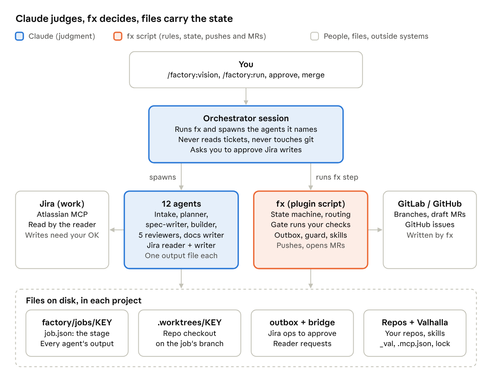
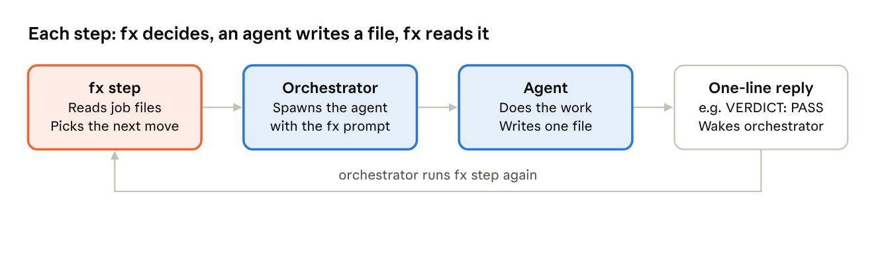
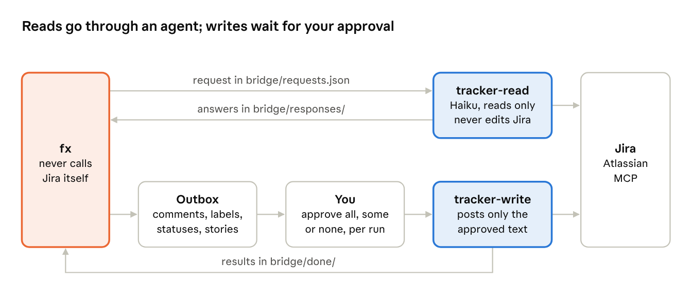

# How it works

Claude does the judgment work, a deterministic script (`fx`) holds every rule
and every decision, and files on disk carry the state between them. Nothing
reaches Jira until you approve it, and nothing merges until you merge it.

- [The parts](#the-parts)
- [How one step works](#how-one-step-works)
- [From an idea: /factory:vision](#from-an-idea-factoryvision)
- [The central plan](#the-central-plan)
- [A job's life](#a-jobs-life)
- [Jira at work, spec files at home](#jira-at-work-spec-files-at-home)
- [Documentation](#documentation)
- [Your house style](#your-house-style)
- [Company skills (Valhalla)](#company-skills-valhalla)
- [Safety](#safety)

## The parts

**You** shape the work with `/factory:vision`, start runs with
`/factory:run`, approve plans and Jira writes, and merge. The skills run `fx`
for you, ask you only for decisions, and end each step by telling you what
comes next.

**The orchestrator** is your Claude Code session after you type
`/factory:run`, driven by the plugin's `run` skill. It makes no decisions: it
runs `fx`, spawns the agents `fx` names, and reports one line per change. At
the end of a run it shows you the Jira writes waiting for approval. It never
reads agent files or ticket text and never touches git, Jira or GitLab
itself, so its context lasts a whole run.

**`fx`** (the plugin's `bin/fx`, plain Python with no dependencies, on your
PATH inside Claude Code) holds every rule:

- **State machine:** each job's stage lives in `job.json`, and only `fx`
  writes it. Illegal moves are refused.
- **Routing:** picks the lane, the repo and the model for each role.
- **Gate:** runs the project's checks script from the factory's own copy, so
  a branch can't weaken it.
- **Trackers:** Jira through the Atlassian MCP bridge, GitHub issues, and the
  local spec queue, routed by key (`ABC-123`, `GH-12`, `SPEC-3`).
- **Forges:** GitLab through `glab`, GitHub through `gh`. `fx` pushes
  branches and opens merge requests.
- **Outbox:** every Jira write (comment, label, status, new ticket) waits
  there for your approval.
- **Guard hook:** a plugin hook that blocks unsafe actions by factory agents
  only.
- **Skills sync:** keeps the optional company skills integration up to date.

Because it's ordinary code, it's tested and behaves the same way every time.

**The agents** (the plugin's `agents/`, run as `factory:<name>`) do the
judgment work. Each one reads files, writes exactly one file, and replies with
that file's first line (for example `VERDICT: CHANGES`). Models are the `work`
profile defaults and can be changed in the config.

| Agent | Writes | Default model |
| --- | --- | --- |
| intake | `intake.md` | Sonnet |
| planner | `plan.md` (the central plan, or an epic's plan) | Opus |
| spec-writer | `spec.md` | Opus |
| builder | commits + `build.md` (the MR description) | Sonnet |
| reviewer-code | `review-code.md` | Haiku, Sonnet or Opus by risk |
| reviewer-security | `review-security.md` | Opus |
| reviewer-ui | `review-ui.md` | Sonnet |
| reviewer-data | `review-data.md` | Sonnet |
| reviewer-docs | `review-docs.md` | Haiku or Sonnet by risk |
| docs-writer | `docs/*.md` drafts + `docs.md` | Sonnet |
| tracker-read | Jira answers in `bridge/responses/` | Haiku |
| tracker-write | approved Jira writes, results in `bridge/done/` | Haiku |

**The files** are the shared memory. Each project holds its own:

| Folder | Holds |
| --- | --- |
| `factory/config.json`, `factory/checks.sh` | The project's settings and checks (commit these) |
| `factory/jobs/<KEY>/` | A job's state and every agent's output, including documentation drafts |
| `.worktrees/<KEY>/` | An isolated checkout of the target repo on the job's branch |
| `factory/briefs/<slug>/` | `/factory:vision` briefs, their specs, and the central plan |
| `factory/specs/` | Approved specs by ticket key, dependencies, epic documentation plans |
| `factory/queue/` | Local spec tickets (`SPEC-n`) on personal projects |
| `factory/outbox/`, `factory/bridge/` | Jira writes waiting for approval; the Jira reader's and writer's requests and answers |

Since all state is on disk, a crashed or compacted session loses nothing: the
next `/factory:run` picks every job up where it stopped.

## How one step works

A job moves forward one step at a time: `fx step` decides, the orchestrator
spawns, an agent writes a file, and `fx step` runs again.

`fx step KEY` looks at the job's stage and files, makes every deterministic
move it can, then stops at the first thing that needs Claude or a person. It
prints one instruction:

| Instruction | What the orchestrator does |
| --- | --- |
| `NEXT spawn` + agent specs | Passes each spec (agent, model, prompt) on unchanged; several reviewers run in parallel |
| `NEXT gate` | Runs `fx gate KEY` in the background, then steps the job again |
| `NEXT sync` + the Jira reader | Runs the Jira reader agent, waits for it, then runs the same `fx` command again |
| `NEXT wait …` | Nothing: the job is waiting on a person |
| `NEXT done …` | Nothing: the job is finished |

Each prompt is one header line that `fx` builds, naming the job folder,
worktree, branch, repo, round and port, plus the required and discoverable
skills. Agents learn everything else from files, which is what keeps the
orchestrator cheap.

## From an idea: /factory:vision

`/factory:vision` turns a rambling idea into reviewed specs, each with a
documentation plan, before anything reaches the queue.

1. **Listen.** You ramble across as many messages as you like. It keeps a
   running digest in `factory/briefs/<name>/brief.md`.
2. **Mirror.** It plays the idea back, asks at most three questions at a
   time, flags contradictions, and suggests a smaller first slice.
3. **Ground and size.** A subagent checks the idea against the code and picks
   the repo. Anything bigger than one merge request becomes stories you
   approve.
4. **Write.** Specs use the factory's own format, including a Documentation
   section that plans which documents to produce, for whom, and whether they
   live in the repo or outside it. A spec with an open question stays a draft.
5. **Review.** You edit the specs and mark them ready.
6. **Plan.** The planner plans the whole build (next section).
7. **File.** You choose where it goes: the local spec queue or GitHub issues
   on personal projects, Jira at work, or nowhere yet.

**From an existing ticket:** `/factory:vision SSP-123` (or `GH-12`, `SPEC-3`)
starts the brief from that ticket. `fx ticket` reads it through the project's
tracker (at work, the Jira reader agent) and copies it into `ticket.md` as
quoted data, with only the reporter's and your comments. The brief starts from
the ticket and moves straight to questions about its gaps. Filing then goes
onto that ticket instead of a new one. The skill runs every `fx` command
itself; you only make the decisions.

Briefs live in files, so you can `/clear` and pick up again with
`/factory:vision <name>`.

## The central plan

The planner (Opus, in its own context) plans the whole build once, after
`/factory:vision` and before anything reaches the queue, and you approve it
before a single ticket exists.

- **Waves:** stories in the same wave can be built at the same time; later
  waves start when the stories they depend on merge.
- **Shared contracts:** the data model, interfaces and naming every story
  builds against, decided once and built first.
- **Touch points:** the files each story will change. `fx plan` warns when
  two stories in the same wave touch the same place.
- **Documentation:** the feature-level documents, such as an overview or tech
  spec, written once all the stories have merged.

`/factory:vision` shows you the plan and asks: approve it, or send it back
with your notes (`fx plan SLUG --approve` or `--redo` underneath). Once you
choose where it goes, it files the epic and every story in order,
each with its reviewed spec and dependencies. On Jira the epic goes through
your approval first, then all its stories in one batch; a story whose
dependency isn't created yet stays blocked until it is. If you create the
tickets with your own ticket skill instead, the skill attaches them to the
plan (`fx plan SLUG --link`).

A brief started from a ticket files onto it. With one story, the reviewed spec
is attached to the ticket and the ticket gets the queue label. With several,
the ticket becomes the epic and every story is filed under it; the queue holds
an epic like that and never builds it itself.

A ticket filed from a reviewed spec skips the spec-writer: the factory builds
from the approved copy in `factory/specs/<KEY>.md`, not from ticket text,
which anyone can edit. Tickets that reach the factory without a plan and turn
out too big still get the planner inside the run, as an epic.

## A job's life

Every job ends as a ready merge request for you to merge, a question waiting
on a person, or a rejection.

1. **Queue.** `fx queue` reads your queue (Jira JQL, labelled GitHub issues or
   local spec files), starts new jobs up to `concurrency`, and holds the rest.
   `fx create` copies the ticket into `issue.md` as quoted data and pre-picks
   the repo from components or labels.
2. **Intake** writes `intake.md`: accept, ask the reporter, or reject; then
   lane, risk, affected areas (UI, security, data) and repo. If it needs
   answers, the job parks as `needs-info` until the reporter (or you, via
   `fx answer`) replies.
3. **Lane.**
   - Hotfix goes straight to the builder.
   - Feature gets a `spec.md` first, unless it arrived with an approved one.
   - An epic filed without a central plan gets a `plan.md` you approve; `fx`
     then creates its stories, which come back through the queue in order.
4. **Build.** The builder commits in the job's worktree, including the in-repo
   docs the spec planned, and writes `build.md`, which becomes the MR
   description. `fx` checks the tree is clean and has commits, pushes, and
   opens a draft MR.
5. **Gate.** `fx` runs the repo's checks script. It fails the build if a
   protected path changed, and flags sensitive paths for you. A failure goes
   back to the builder with the log tail, and no reviewer runs.
6. **Review.** Only the reviewers the job needs run, in parallel, and features
   always get a docs reviewer. Any `CHANGES` sends the job to the next round.
7. **Docs.** If the spec planned external documents, the docs writer drafts
   them into the job folder, ready for you to publish after merge.
8. **Ready.** `fx` checks the branch still merges cleanly, takes the MR out of
   draft with a summary note, and updates the ticket. At work that's an
   Implementation update and the move to your "ready" status, both waiting
   for your approval. You merge; the next queue run notices and closes out the
   job.

Each lane has a round limit (2 for hotfix, 3 for feature). When it's used up,
or an agent reports `BLOCKED`, the job becomes `needs-human`, with the reason
posted on the MR and the ticket. `fx feedback` gives the builder your notes and
a fresh set of rounds.

| Stage | Kind |
| --- | --- |
| `intake`, `plan`, `spec`, `build`, `gate`, `review`, `docs` | Running |
| `needs-info`, `plan-review`, `ready`, `needs-human` | Waiting on a person |
| `merged`, `closed`, `rejected`, `planned` | Finished |

## Jira at work, spec files at home

Work projects queue from Jira; personal projects queue from local spec files
and GitHub issues, and never touch Jira.

| | Work profile | Personal profile |
| --- | --- | --- |
| Queue | Jira tickets your JQL selects | `factory/queue/SPEC-n.md` files and labelled GitHub issues |
| Ticket reads | Jira reader agent, through the Atlassian MCP | Files and `gh` |
| Ticket writes | Wait in the outbox for your approval | Immediate |
| Merge requests | GitLab draft MRs | GitHub draft pull requests |
| Ticket updates | Your Implementation update format (Progress, Next, Blockers, Evidence) | Short factory notes |

No Jira token lives on your machine, because `fx` never calls Jira. When it
needs ticket data it prints `NEXT sync`; the orchestrator runs the Jira
reader, and `fx` carries on with the answers.

At the end of each `/factory:run` you see the pending writes in one table and
approve all, some or none; `fx outbox` lists them any time. Two kinds hold up
work until approved: a question to a reporter (the job starts waiting for a
reply only once it's posted) and an epic's stories (created only after you
approve them). The writer agent can post only the exact approved text, on the
approved ticket; a guard hook enforces it.

A REST mode (`"tracker": "jira"` with `JIRA_EMAIL` and `JIRA_API_TOKEN`)
remains for machines without the MCP.

## Documentation

Documentation is planned with the work and checked like code, so merged work
arrives with the documents its readers need.

1. **Plan.** `/factory:vision`, the spec-writer and the planner give every
   spec and plan a Documentation section. Each entry is in-repo or external
   and names its reader: an ADR for a design decision, a README change, an
   accessible tech spec or high-level overview, a guide, a runbook.
2. **Write in-repo docs.** The builder writes them in the same merge request,
   following your changelog and ADR folder conventions.
3. **Review.** The docs reviewer sends the job back if a planned document is
   missing or describes behaviour the code doesn't have.
4. **Draft external docs.** After review, the docs writer drafts them in your
   `atlassian-work` page templates, inside the job folder.
5. **Publish.** `/factory:docs` checks each draft against the merged commit
   and publishes it through `atlassian-work`'s preview and approval.
   Documents about a whole feature are written once all its stories have
   merged.

Documents don't map one-to-one to tickets: one overview can cover a whole
epic, and a small fix may need only a changelog line.

## Your house style

`outputs` in `factory/config.json` points the factory at skills you already
use.

| Setting | Skill | What the factory takes from it |
| --- | --- | --- |
| `mr_skill` | gitlab-mr | MR titles (`ABC-123: summary`), branch names, and the What, How, Testing, Risk and rollback, Checklist description. A repo MR template still wins |
| `docs_skill` | atlassian-work | Confluence page templates for drafts, and the preview-and-approve publishing flow |
| `ticket_skill` | Yours, optional | `/factory:vision` creates Jira tickets with it, then attaches the reviewed specs |
| `jira_update_format` | `implementation-update` | Ticket comments as Progress, Next, Blockers and Evidence |

Builders use the MR skill's format only, not its commit and push steps,
because `fx` pushes and opens the MR.

## Company skills (Valhalla)

The integration is off by default; `fx skills on` turns it on for one
workspace, and `fx skills off` removes it again. When it's on:

- **Header lines.** Each prompt carries `Skills:` (the role's pinned skills,
  resolved against what's installed) and `Discover skills: yes`, so agents
  also pick up other fitting skills.
- **Pins in the prompt.** Plugin agents are shared by every project, so pinned
  skills travel in each prompt and agents load them with the Skill tool. Pins
  can be glob patterns, so a renamed or new skill is picked up.
- **Enforcement.** `fx` sends back any output that doesn't list the pinned
  skills it applied.
- **Re-sync.** Whenever `.valhalla.lock` or the installed skills change, the
  next run re-resolves the pins.
- **Protection.** `_val/`, the library's skills, `.mcp.json` and the lock file
  are protected from agents.

## Safety

Six layers stand between a ticket and your main branch, and each catches what
the one before might miss.

1. **Trust boundary.** Only your JQL, queue label or local queue selects work.
2. **Quoted ticket text.** The ticket reaches agents only as data between
   random markers.
3. **Guard hook on every factory agent.** It is a plugin hook that leaves your
   own sessions and other agents alone. It blocks:
   - pushes, rebases, force-pushes, hard resets and branch switches;
   - git writes by any role except the builder;
   - MCP write tools, except the Jira writer's approved operations;
   - writes outside the job folder or worktree;
   - edits to protected paths.
4. **Gate.** It runs the factory's copy of the checks, not the branch's.
5. **Approval.** Every Jira write waits in the outbox until you approve it,
   and the writer can post only that exact text, on that ticket.
6. **Humans merge.** No merge happens without you.
